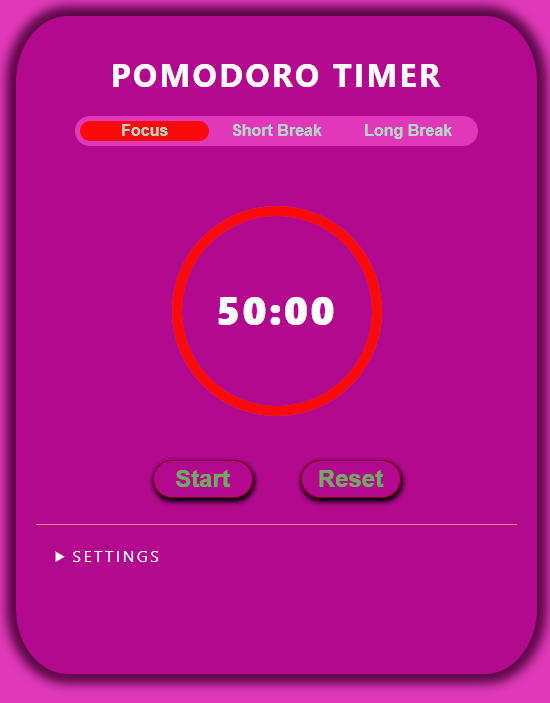

# 🍅 Pomodoro Timer

A clean, customizable Pomodoro timer web application designed to boost productivity by breaking work into focused intervals separated by short breaks.

url : https://pomodor-seven.vercel.app/

---

## 📌 Project Premise

The **Pomodoro Technique** is a time management method that uses a timer to break down work into intervals (traditionally 25 minutes of focused work), separated by short breaks.

This project delivers an interactive, distraction-free web timer with:

- **3 Modes**: Focus session, Short Break, and Long Break.
- **Visual Progress Ring**: An SVG animated circle that depletes smoothly as time ticks down.
- **Audio Chime**: An alert sound synthesized via Web Audio API when a session concludes.
- **Customizable Durations**: A settings drawer allowing users to customize time intervals for all 3 modes (with scrubbable number adjustments).

---

## 🎨 Product Illustration

## 🚀 Features

- **Dynamic Modes**: Quickly toggle between _Focus_, _Short Break_, and _Long Break_ presets.
- **Smooth SVG Progress Animation**: Real-time circular countdown synchronized with CSS transitions.
- **Zero-Dependency Sound**: Built-in sound generation with the HTML5 Web Audio API—no audio files needed.
- **Collapsible Settings**: Adjust interval durations at any time using `
` and live inputs.
- **Clean UI**: Responsive card layout with dark modern styling.

---

## 🛠️ Tech Stack

- **HTML5**: Semantic layout and SVG elements (`<circle>`, `
`, `<nav>`).
- **CSS3**: Flexbox, CSS Grid, custom properties (variables), and SVG stroke animations.
- **JavaScript (ES6+)**: DOM manipulation, `setInterval` timer state management, and Web Audio API synthesizer.

---

## 💻 Getting Started

1. Clone or download this repository.
2. Open `index.html` in any modern web browser.
3. Choose your mode, adjust your duration in **Settings** if desired, and click **Start**!
